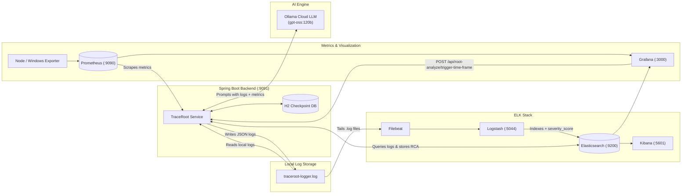

# TraceRoot — AI Log Insight and Root Cause Analysis Assistant

**TraceRoot** is an automated backend log analysis and Root Cause Analysis (RCA) service built with **Spring Boot**, **Spring AI (Ollama Cloud)**, the **ELK Stack (Filebeat, Logstash, Elasticsearch, Kibana)**, **Prometheus**, and **Grafana**.

It continuously monitors application logs and live system metrics to automatically detect root causes, identify affected components, and recommend concrete remediation steps whenever critical incidents (`WARN` / `ERROR`) occur.

---

## System Architecture and Workflow



1. **Flow 1 — Log Generation**: When `TraceRoot` runs, Logback (`logback-spring.xml`) outputs structured Logstash-JSON logs to `${LOG_FILE_PATH}/traceroot-logger.log` and rotates daily/size-based archives (`traceroot-logger.YYYY-MM-DD.i.log`).
2. **Flow 2 — ELK Ingestion**: **Filebeat** tails the `.log` files and forwards events to **Logstash**, which parses the JSON payload, assigns a `severity_score` (`ERROR = 3`, `WARN = 2`, `INFO = 1`), and indexes documents into **Elasticsearch** (`traceroot-log-rca-assistant-*`) for **Kibana** visualization.
3. **Flow 3 — System Metrics Collection**: **Prometheus** scrapes host metrics (CPU usage, available RAM, network throughput, disk read/write latency) and Spring Boot Actuator metrics, which are visualized in **Grafana**.
4. **Flow 4 — Automated and On-Demand AI Root Cause Analysis**:
   - **Scheduled Monitor**: Every 60 seconds, `LogMonitorService` compares new critical logs in Elasticsearch against the last checkpoint stored in the local H2 database (`RootAnalyzeLastCheckpoint`). When `>= 5` new critical logs are found, it collects live Prometheus metrics via `MetricService`, sends the combined prompt to **Ollama Cloud** (`OllamaService`), and saves the structured `RootAnalyzeOutput` into Elasticsearch (`traceroot-log-rca-result-YYYY-MM-DD`).
   - **On-Demand Time-Frame Trigger**: Grafana (or any REST client) can trigger an analysis for a specific time window via `POST /api/root-analyze/trigger-time-frame` (`RootAnalyzeController`), which writes results to `traceroot-log-rca-time-frame-YYYY-MM-DD`.

---

## Tech Stack & Default Ports

| Component | Technology / Version | Default Port |
| :--- | :--- | :--- |
| **Backend Service** | Java 21, Spring Boot 3.5.9, Spring AI 1.1.2 | `9091` |
| **AI Model** | Ollama Cloud (`gpt-oss:120b`) | HTTPS (`ollama.com`) |
| **Checkpoint DB** | H2 Database (File-based) | Local File (`last-log-checkpoint.mv.db`) |
| **Elasticsearch** | `8.15.0` | `9200` |
| **Logstash** | `8.15.0` | `5044` (Beats) |
| **Kibana** | `8.15.0` | `5601` |
| **Filebeat** | `8.15.0` | Container Agent |
| **Prometheus** | `latest` | `9090` |
| **Grafana** | `latest` | `3000` |

---

## 1. Creating the `.env` File

On startup, `TraceRoot.java` loads environment variables from a `.env` file in the project root using `dotenv-java` and registers them as JVM system properties for `application.properties` and `logback-spring.xml`.

Create a `.env` file in the `TraceRoot/` directory (next to `pom.xml`):

```dotenv
## Ollama Cloud API Key
OLLAMA_API_KEY=your_ollama_cloud_api_key_here

## Change with your H2 file path (stores the last RCA log checkpoint)
DATASOURCE_URL=jdbc:h2:file:/absolute/path/to/TraceRoot/last-log-checkpoint

## Directory path to your .log files (changes based on your OS, no trailing slash)
LOG_FILE_PATH=/absolute/path/to/TraceRoot
```

### Variable Reference
- **`OLLAMA_API_KEY`**: Bearer token for authenticating with `https://ollama.com/api/chat` (`gpt-oss:120b`).
- **`DATASOURCE_URL`**: File-based H2 database URL used by `RootAnalyzeLastCheckpointRepository` to persist the `lastCheckedAt` and `lastRcaTriggeredAt` timestamps across restarts.
- **`LOG_FILE_PATH`**: Absolute directory path (without a trailing `/`) where `traceroot-logger.log` is written by Logback and read by `LogReaderService`.
  - **macOS / Linux example**: `/Users/username/Documents/TraceRoot`
  - **Windows example**: `C:/Users/username/Documents/TraceRoot` *(use forward slashes `/`)*

---

## 2. How to Place the Main Log File as Initial Log to Test

Both `logback-spring.xml` and `LogReaderService` use `LOG_FILE_PATH` from your `.env` to locate log files:

- **Main Active Log File**: `${LOG_FILE_PATH}/traceroot-logger.log`
- **Rolled Historical Log Files**: `${LOG_FILE_PATH}/traceroot-logger.YYYY-MM-DD.i.log` (e.g., `traceroot-logger.2026-10-25.0.log`)

### Option A: Place a Pre-existing `traceroot-logger.log` File
1. Copy or create your initial log file inside the directory pointed to by `LOG_FILE_PATH` and name it **`traceroot-logger.log`**:
   ```text
   <LOG_FILE_PATH>/
   ├── last-log-checkpoint.mv.db          # Auto-generated by H2
   ├── traceroot-logger.log               # <-- Place your main initial log file here
   └── traceroot-logger.2026-10-25.0.log  # <-- (Optional) Rolled date-stamped logs
   ```
2. Ensure each line in `traceroot-logger.log` is a valid single-line JSON log object (as produced by `LogstashEncoder`):
   ```json
   {"@timestamp":"2026-10-27T09:42:55.119619+07:00","@version":"1","message":"Database connection timeout","logger_name":"com.dev.RCA.service.LogMonitorService","thread_name":"scheduling-1","level":"ERROR","level_value":40000,"stack_trace":"java.lang.RuntimeException: Connection refused\n\tat com.dev.RCA.service.DummyLogService.generateDummyLog(DummyLogService.java:15)"}
   ```
3. **Testing Local Log Reading**: When testing via `GET /api/testing/read-local-logs?durationOption=6 hours`, `LogReaderService` filters entries by their `@timestamp` field and only returns `WARN` and `ERROR` logs within the selected window (`5 minutes`, `15 minutes`, `30 minutes`, `1 hour`, `3 hours`, `6 hours`, `12 hours`, `24 hours`, `2 days`, `7 days`, or `30 days` by default).

### Option B: Generate Initial Test Logs via the Built-in API
If you start the application without an existing log file, Logback automatically creates `${LOG_FILE_PATH}/traceroot-logger.log`. You can then inject test `ERROR` or `WARN` logs using `RootTestingController`:

```bash
# Run 5 times to cross the >= 5 critical log threshold for automatic scheduled RCA
curl "http://localhost:9091/api/testing/generate-dummy-log?level=ERROR&message=Database+connection+timeout"
```

---

## 3. Docker Compose Setup (ELK, Prometheus, Grafana)

Create a `docker-traceroot/` directory to hold the container orchestration and configuration files:

```text
docker-traceroot/
├── docker-compose.yml
└── pipelines/
    ├── filebeat.yml
    ├── logstash.conf
    ├── elasticsearch.yml
    ├── prometheus.yml
    └── logstash.conf
```

### 3.1 `docker-compose.yml`

```yaml
services:
  elasticsearch:
    image: docker.elastic.co/elasticsearch/elasticsearch:8.15.0
    container_name: traceroot-elasticsearch
    environment:
      - "ES_JAVA_OPTS=-Xms512m -Xms512m" # Limits RAM usage to 512MB
    volumes:
      - ./pipelines/elasticsearch.yml:/usr/share/elasticsearch/config/elasticsearch.yml:ro # Path folder used in mac (1st path)
      - esdata:/usr/share/elasticsearch/data
    ports:
      - "9200:9200"
    networks:
      - traceroot-elk

  logstash:
    image: docker.elastic.co/logstash/logstash:8.15.0
    container_name: traceroot-logstash
    environment:
      - "LS_JAVA_OPTS=-Xms256m -Xms256m" # Limits RAM usage to 256MB
    volumes:
      - ./logstash/logstash.conf:/usr/share/logstash/pipeline/logstash.conf:ro # Path folder used in mac (1st path)
    ports:
      - "5044:5044"
    depends_on:
      - elasticsearch
    networks:
      - traceroot-elk

  filebeat:
    image: docker.elastic.co/beats/filebeat:8.15.0
    container_name: traceroot-filebeat
    user: root
    command: ["--strict.perms=false", "-e"]
    volumes:
      - ./filebeat/filebeat.yml:/usr/share/filebeat/filebeat.yml:ro # Path folder in mac (1st path)
      # Replace /absolute/path/to/TraceRoot with your LOG_FILE_PATH from .env
      - /absolute/path/to/TraceRoot:/logs:ro
    depends_on:
      - logstash
    networks:
      - traceroot-elk

  kibana:
    image: docker.elastic.co/kibana/kibana:8.15.0
    container_name: traceroot-kibana
    volumes:
      - ./pipelines/kibana.yml:/usr/share/kibana/config/kibana.yml:ro
    ports:
      - "5601:5601"
    depends_on:
      - elasticsearch
    networks:
      - traceroot-elk

  prometheus:
    image: prom/prometheus:latest
    container_name: traceroot-prometheus
    ports:
      - "9090:9090"
    volumes:
      - ./pipelines/prometheus.yml:/etc/prometheus/prometheus.yml
      - prometheus_data:/prometheus
    command:
      - '--config.file=/etc/prometheus/prometheus.yml'
    restart: unless-stopped

  grafana:
    image: grafana/grafana:latest
    container_name: traceroot-grafana
    ports:
      - "3000:3000"
    depends_on:
      - prometheus
      - elasticsearch
    environment:
      - GF_SECURITY_ADMIN_USER=admin
      - GF_SECURITY_ADMIN_PASSWORD=admin
    volumes:
      - grafana_data:/var/lib/grafana
    networks: unless-stopped

volumes:
  esdata:
  prometheus_data:
  grafana_data:

networks:
  traceroot-elk:
    driver: bridge
```

### 3.2 `pipelines/filebeat.yml`

Mounts your host `LOG_FILE_PATH` and ships `traceroot-logger.log` events to Logstash:

```yaml
filebeat.inputs:
  - type: filestream
    id: traceroot-logs-id
    enabled: true
    paths:
      - /logs/traceroot-logger.log

output.logstash:
  hosts: ["logstash:5044"]
```

### 3.3 `pipelines/logstash.conf`

`LogQueryService` searches the `traceroot-log-rca-assistant-*` index and filters by `severity_score` (`1` = `INFO`, `2` = `WARN`, `3` = `ERROR`). Configure Logstash to parse the JSON log line and compute `severity_score`:

```ruby
input {
  beats {
    port => 5044
  }
}

filter {
  json {
    source => "message"
    skip_on_invalid_json => true
  }

  if [level] == "ERROR" {
    mutate { add_field => { "severity_score" => 3 } }
  } else if [level] == "WARN" {
    mutate { add_field => { "severity_score" => 2 } }
  } else {
    mutate { add_field => { "severity_score" => 1 } }
  }

  mutate {
    convert => { "severity_score" => "integer" }
  }

  mutate {
    remove_field => [
      "host",
      "ecs",
      "input",
      "log",
      "@version",
      "event",
      "tags",
      "agent",
      "sort"
    ]
  }
}

output {
  elasticsearch {
    hosts => ["http://elasticsearch:9200"]
    index => "traceroot-log-rca-assistant-%{+YYYY.MM.dd}"
  }
  stdout { codec => rubydebug }
}
```

### 3.4 `pipelines/elasticsearch.yml`

Configures ElasticSearch to distributed search, storage, and analytics engine.

```yaml
cluster.name: "docker-cluster"
network.host: 0.0.0.0
discovery.type: single-node
xpack.security.enabled: false
```

### 3.5 `pipelines/kibana.yml`

Configures Kibana to provide visualization and management user interface layer.

```yaml
server.name: kibana
server.host: "0.0.0.0"
elasticsearch.hosts: ["http://elasticsearch:9200"]
```

### 3.6 `pipelines/prometheus.yml`

Configures Prometheus to scrape the Spring Boot `/actuator/prometheus` endpoint and your host OS exporter:

```yaml
global:
  scrape_interval: 15s

scrape_configs:
  - job_name: "prometheus"
    static_configs:
      - targets: ["localhost:9090"]
```

### 3.7 Starting the Docker Stack

```bash
cd docker
docker compose up -d
```

Once running, access the services at:
- **Elasticsearch**: `http://localhost:9200`
- **Kibana**: `http://localhost:5601`
- **Prometheus**: `http://localhost:9090`
- **Grafana**: `http://localhost:3000` (Default credentials: `admin` / `admin`)
  - Add **Prometheus** data source: `http://prometheus:9090`
  - Add **Elasticsearch** data sources for indices:
    - `traceroot-log-rca-assistant-*` (Raw and enriched application logs)
    - `traceroot-log-rca-result-*` (Scheduled Root Cause Analysis outputs)
    - `traceroot-log-rca-time-frame-*` (Time-frame triggered Root Cause Analysis outputs)

---

## 4. Running the Spring Boot Application

From the `TraceRoot` project directory:

```bash
cd TraceRoot
./mvnw spring-boot:run
```

The backend server will start on **`http://localhost:9091`**.

---

## 5. API Endpoints Reference

### Root Analyze Controller (`/api/root-analyze`)
| Method | Endpoint | Query Params | Description |
| :--- | :--- | :--- | :--- |
| `POST` | `/api/root-analyze/trigger-time-frame` | `from` (epoch ms), `to` (epoch ms) | Fetches critical logs (`severity_score >= 2`) between `from` and `to`, queries Prometheus metrics, runs Ollama RCA, and indexes the result into `traceroot-log-rca-time-frame-YYYY-MM-DD`. |

### Testing Controller (`/api/testing`)
| Method | Endpoint | Query Params | Description |
| :--- | :--- | :--- | :--- |
| `GET` | `/api/testing/generate-dummy-log` | `level` (`INFO`/`WARN`/`ERROR`), `message` | Writes a test log entry (with stack trace on `ERROR`) to `traceroot-logger.log`. |
| `GET` | `/api/testing/read-local-logs` | `durationOption` (default: `6 hours`) | Reads `WARN`/`ERROR` logs directly from local `traceroot-logger*.log` files in `LOG_FILE_PATH`. |
| `GET` | `/api/testing/generate-rca-with-local-logs` | `durationOption` (default: `6 hours`) | Generates AI RCA directly from local `.log` files + live Prometheus metrics. |
| `GET` | `/api/testing/all-critical-log` | *(none)* | Returns all logs with `severity_score >= 1` from Elasticsearch (`traceroot-log-rca-assistant-*`). |
| `GET` | `/api/testing/get-root-analyze-output` | *(none)* | Retrieves all stored AI RCA results from `traceroot-log-rca-result-*`. |
| `GET` | `/api/testing/generate-root-analyze-output` | *(none)* | Generates AI RCA from Elasticsearch critical logs (`severity_score >= 2`) + live Prometheus metrics. |
| `GET` | `/api/testing/generate-root-analyze-with-info` | *(none)* | Generates AI RCA including `INFO` logs (`severity_score >= 1`) + live Prometheus metrics. |
| `GET` | `/api/testing/generate-root-analyze-with-max-metrics` | *(none)* | Simulates high resource stress (`99%` CPU, `0.2 GB` free RAM, `100ms` disk latency) and generates AI RCA. |
| `GET` | `/api/testing/count-critical-log` | `lastTriggered` (ISO-8601), `minScore` | Counts critical logs in Elasticsearch since `lastTriggered`. |
| `GET` | `/api/testing/get-new-log` | `lastTriggered` (ISO-8601), `minScore` | Fetches critical logs in Elasticsearch since `lastTriggered`. |
| `GET` | `/api/testing/get-metrics` | *(none)* | Returns current system metrics parsed from Prometheus (`SystemMetric`). |
| `GET` | `/api/testing/instant-metrics` | `promQl` | Executes a raw PromQL instant query against Prometheus. |
| `GET` | `/api/testing/generate-h2` | *(none)* | Returns the checkpoint rows stored in the local H2 database. |
